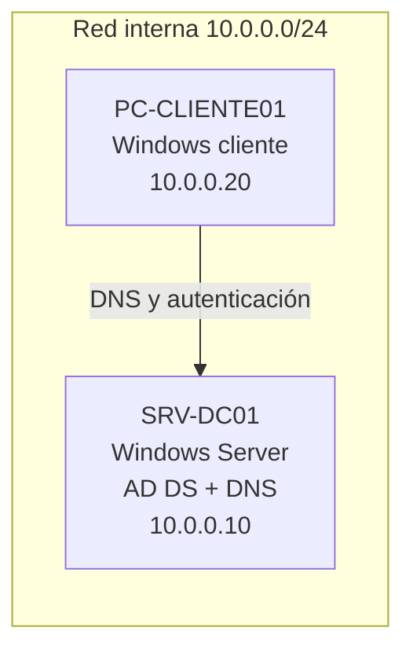

# Laboratorio de Active Directory

Laboratorio en máquinas virtuales para practicar la administración básica de un dominio de Windows: crear el dominio, organizar usuarios y grupos, unir un equipo cliente, resolver tareas de soporte (restablecer contraseñas, desbloquear cuentas) y aplicar políticas de grupo (GPO).

> **Estado: en construcción.** Cada punto de la lista de abajo se marca solo cuando lo hice y tengo la captura que lo respalda. Todo el laboratorio es local y aislado, con datos ficticios.

## Para qué lo hice

En soporte TI y en seguridad, gran parte del trabajo diario ocurre sobre Active Directory: altas y bajas de usuarios, permisos por grupo, cuentas bloqueadas y políticas de contraseñas. Quise entender cómo funciona armándolo yo mismo, en lugar de solo leer sobre el tema.

## Entorno

| Elemento | Detalle |
|---|---|
| Virtualización | VirtualBox |
| Servidor | Windows Server (versión de evaluación de 180 días), nombre `SRV-DC01` |
| Cliente | Windows 10/11, nombre `PC-CLIENTE01` |
| Dominio | `lab.local` (solo para pruebas internas) |
| Red | Red interna de VirtualBox, `10.0.0.0/24`, sin salida a mi red real |



## Avance

- [ ] 1. Crear las máquinas virtuales y la red interna
- [ ] 2. Instalar Active Directory y crear el dominio `lab.local`
- [ ] 3. Crear unidades organizativas, usuarios y grupos
- [ ] 4. Unir el cliente al dominio e iniciar sesión con un usuario del dominio
- [ ] 5. Tareas de soporte: restablecer contraseña, desbloquear y deshabilitar cuentas
- [ ] 6. Aplicar políticas de grupo (política de contraseñas y una GPO por unidad)
- [ ] 7. Revisar en el visor de eventos los inicios de sesión y bloqueos

La guía detallada de cada paso está en [`docs/guia-paso-a-paso.md`](docs/guia-paso-a-paso.md). Las capturas van en [`capturas/`](capturas/).

## Estructura del dominio

> Completar con la estructura real cuando esté creada.

```
lab.local
├── Empleados
│   ├── Ventas
│   └── TI
├── Equipos
└── Grupos
```

## Problemas que tuve y cómo los resolví

> Esta sección se llena durante el laboratorio. Es la más importante: anotar cada error real, qué causó y cómo lo solucioné.

| Problema | Causa | Solución |
|---|---|---|
| _pendiente_ | | |

## Qué aprendí

> Completar al terminar, con mis propias palabras.

## Seguridad del laboratorio

- Todo corre en una red interna aislada, sin conexión a redes reales.
- Los usuarios, nombres y contraseñas son ficticios. No hay datos de ninguna empresa.
- No se suben imágenes de máquinas virtuales ni claves al repositorio (ver `.gitignore`).
- Uso licencias de evaluación de Microsoft, descargadas del [Evaluation Center](https://www.microsoft.com/evalcenter).

## Próximos pasos

- Usar los eventos de inicio de sesión fallido de este laboratorio para un proyecto de análisis de logs con Python.
- Evaluar los controles del laboratorio contra ISO 27001 y NIST CSF.
